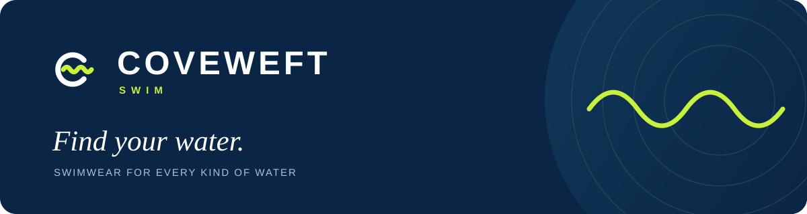

<p align="center">
  
</p>

<p align="center">
  A swimwear storefront for every kind of water.<br />
  <strong>Next.js · TypeScript · Tailwind CSS · Supabase</strong>
</p>

<p align="center">
  <a href="#run-locally">Run locally</a> ·
  <a href="#demo-accounts">Demo accounts</a> ·
  <a href="#development">Development</a> ·
  <a href="docs/architecture.md">Architecture</a> ·
  <a href="#tiếng-việt">Tiếng Việt</a>
</p>

## Meet COVEWEFT

COVEWEFT Swim is a B2C e-commerce demo for **CO3027 Electronic Commerce** at
Ho Chi Minh City University of Technology (HCMUT), semester 261.
The brand is fictional; payments and deliveries are simulated.

| Discover                                          | Shop                                                | Manage                               |
| ------------------------------------------------- | --------------------------------------------------- | ------------------------------------ |
| Search, filters, studio galleries, and favorites. | Size selection, cart, checkout, and order tracking. | Products, images, stock, and orders. |

The **Shopping Assistant** finds products, checks availability, and suggests
sizes from the Demo Size Guide. The storefront supports **English and Vietnamese**,
with prices in **VND**.
Checkout supports COD and simulated bank transfers.

The [catalog snapshot](data/catalog/SOURCE.md) includes **475 products**, **1,541
variants**, and **3,224 studio photos** (2026-11-06). Product data and photography
come from SOBIE; COVEWEFT's size guide is demo data.

## Run locally

**Install once:** [Docker](https://docs.docker.com/get-started/get-docker/)
(running, with at least 4 GB of memory available) and the
[Supabase CLI](https://supabase.com/docs/guides/local-development/cli/getting-started).
The demo runs in containers; **Node.js, pnpm, a cloud account, and an AI key are
not required**. The first run needs internet access to download images and media.

Clone the repository, then run the command for your system:

```sh
git clone https://github.com/KoangWy/coveweft-swim.git
cd coveweft-swim
```

**macOS / Linux**

```sh
./scripts/demo.sh
```

**Windows · PowerShell**

```powershell
powershell -NoProfile -ExecutionPolicy Bypass -File .\scripts\demo.ps1
```

The script configures `.env.local`, starts Supabase, applies migrations, seeds
the catalog, verifies and extracts the media, creates demo accounts, and starts
the app. **Run the same command again to resume**; existing orders, stock edits,
AI keys, and the media cache are kept. The first run can take several minutes.

| Open        | Address                                                                      |
| ----------- | ---------------------------------------------------------------------------- |
| Storefront  | [English](http://localhost:3000/en) · [Tiếng Việt](http://localhost:3000/vi) |
| Admin       | <http://localhost:3000/en/admin>                                             |
| Database UI | <http://127.0.0.1:54323>                                                     |
| Local email | <http://127.0.0.1:54324>                                                     |

### Demo accounts

Local defaults from [`.env.example`](.env.example):

| Role     | Email                          | Password            |
| -------- | ------------------------------ | ------------------- |
| Customer | `customer@demo.coveweft.local` | `demo-customer-123` |
| Admin    | `admin@demo.coveweft.local`    | `demo-admin-123`    |

Try browsing the shop, signing in as the customer, placing an order, then signing
in as the admin to update its status.

### Stop or reset

Stop both services from the repository directory. Data is kept:

```sh
docker stop coveweft-swim-app
supabase stop
```

To start over, run the reset script. It asks for confirmation, then **deletes
local orders, carts, accounts, and admin edits** and restores the seeded demo.
The media cache and `.env.local` are kept.

```sh
./scripts/reset.sh
```

```powershell
powershell -NoProfile -ExecutionPolicy Bypass -File .\scripts\reset.ps1
```

### Enable the Shopping Assistant

After the first run, add a Mistral key to `.env.local`:

```dotenv
AI_PRIMARY_API_KEY=your-key
AI_FALLBACK_API_KEY=your-key
```

Run the demo command again to apply the keys. The fallback key is optional;
provider and model settings are in [`.env.example`](.env.example). Without a
key, shopping still works and the assistant displays its configuration status.

Conversations belong to the signed-in account and are stored in Postgres, so
they survive a reload and another device. The floating panel is the quick entry;
`/{locale}/assistant` starts a new conversation and
`/{locale}/assistant/{id}` opens a saved one with the conversation rail.
Customers can delete one conversation or all of them from that page; a visitor
sees the sign-in gate and no rail.

Need CLI install commands, another port, an offline media archive, or help with
an error? See [Local development](docs/local-development.md).

## Development

For hot reload, use **Node.js 26** ([`.nvmrc`](.nvmrc)) and **pnpm 12.6.0**
([`package.json`](package.json)). First run the demo above to prepare the local
database, media, accounts, and environment; then follow the
[development setup](docs/local-development.md#hot-reload) to run `pnpm dev`.

| Command                        | Purpose                                    |
| ------------------------------ | ------------------------------------------ |
| `pnpm dev`                     | Start the app with hot reload              |
| `pnpm build` / `pnpm start`    | Build / serve the production app           |
| `pnpm lint` / `pnpm typecheck` | Check code and types                       |
| `pnpm test`                    | Run unit tests; no Docker needed           |
| `pnpm test:integration`        | Test database rules against local Supabase |
| `pnpm test:e2e`                | Run Playwright browser tests               |

## Explore the project

| Guide                                          | Contents                                                          |
| ---------------------------------------------- | ----------------------------------------------------------------- |
| [Local development](docs/local-development.md) | CLI installation, hot reload, manual setup, troubleshooting       |
| [Architecture](docs/architecture.md)           | Module boundaries, database rules, configuration, deployment      |
| [Media pipeline](docs/media.md)                | Image processing, verification, versioned releases, photo credits |
| [Catalog source](data/catalog/SOURCE.md)       | Data provenance, normalization, import validation                 |

Source code is licensed under [MIT](LICENSE). Product data and SOBIE photography
retain their original ownership and are outside the code license; brand photo
credits are in the [media guide](docs/media.md#brand-photography).

<details>
<summary>Tiếng Việt</summary>

### Tiếng Việt

Cửa hàng đồ bơi B2C demo cho môn **CO3027 Electronic Commerce**, Trường Đại học
Bách khoa TP.HCM (HCMUT), học kỳ 261. Thương hiệu giả tưởng; thanh toán và giao
hàng đều mô phỏng.

Bạn có thể tìm/lọc sản phẩm, lưu yêu thích, chọn size, đặt hàng và theo dõi đơn.
Khu vực admin quản lý sản phẩm, ảnh, tồn kho và đơn hàng. **Shopping Assistant**
tư vấn dựa trên catalog, tồn kho và bảng size demo. Giao diện hỗ trợ tiếng Anh,
tiếng Việt và giá VND.

### Chạy local

1. Cài và mở **Docker**, cấp ít nhất 4 GB bộ nhớ; cài **Supabase CLI**.
2. Clone repo và mở terminal trong thư mục `coveweft-swim`.
3. Chạy lệnh theo hệ điều hành:

**macOS / Linux**

```sh
./scripts/demo.sh
```

**Windows · PowerShell**

```powershell
powershell -NoProfile -ExecutionPolicy Bypass -File .\scripts\demo.ps1
```

Script tự chuẩn bị cấu hình, database, catalog, ảnh và tài khoản. Không cần
Node.js, pnpm hay tài khoản cloud. Lần đầu cần internet và có thể mất vài phút;
chạy lại giữ dữ liệu và cache.

Mở **<http://localhost:3000/vi>**; admin ở **<http://localhost:3000/vi/admin>**.

| Vai trò    | Email                          | Mật khẩu            |
| ---------- | ------------------------------ | ------------------- |
| Khách hàng | `customer@demo.coveweft.local` | `demo-customer-123` |
| Admin      | `admin@demo.coveweft.local`    | `demo-admin-123`    |

**Dừng:** chạy `docker stop coveweft-swim-app`, rồi `supabase stop` trong thư mục
repo. Dữ liệu được giữ lại; khởi động lại bằng lệnh demo ở trên.

**Đặt lại:** chạy `./scripts/reset.sh` (macOS/Linux), hoặc
`powershell -NoProfile -ExecutionPolicy Bypass -File .\scripts\reset.ps1`
(Windows). Script yêu cầu xác nhận trước khi **xóa đơn, giỏ hàng, tài khoản và
chỉnh sửa admin ở local**, rồi tạo lại dữ liệu demo.

**Bật Shopping Assistant:** thêm key Mistral vào `AI_PRIMARY_API_KEY` trong
`.env.local`, có thể thêm `AI_FALLBACK_API_KEY`, rồi chạy lại lệnh demo.
Không có key vẫn dùng được cửa hàng.

**Conversation:** hội thoại thuộc tài khoản đã đăng nhập và lưu trong Postgres,
nên tải lại trang hay mở ở máy khác vẫn xem lại được. Panel nổi là lối vào
nhanh; `/{locale}/assistant` mở cuộc mới, `/{locale}/assistant/{id}` mở lại cuộc
đã lưu kèm danh sách conversation. Khách xoá được từng cuộc hoặc tất cả trong
trang này; khách chưa đăng nhập chỉ thấy lời mời đăng nhập.

Hướng dẫn cài CLI, hot reload và xử lý lỗi nằm trong
[Local development](docs/local-development.md) (tiếng Anh).

</details>
